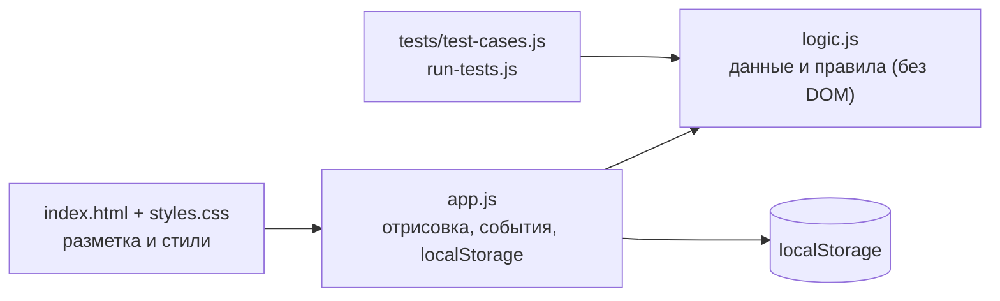
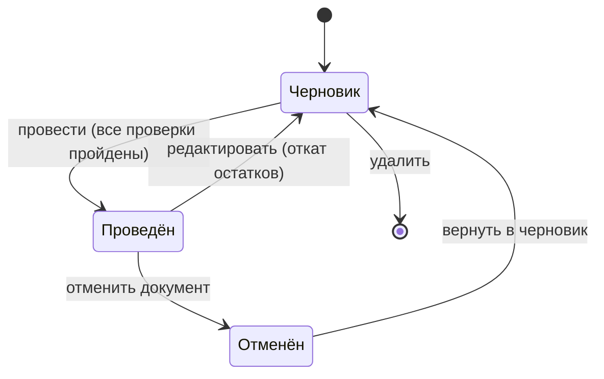

# 3. Проектирование

## Модель жизненного цикла: инкрементная

Выбрана инкрементная модель. Требования к складской системе уточнялись по мере показа очередной версии
(сначала нужны были остатки, затем стало понятно, что без документов учёт не работает, потом понадобились
контрагенты и правка проведённых документов). Каждая версия была работающей и добавляла законченную возможность.

| Инкремент | Что добавлено |
|---|---|
| I1 | Остатки, поиск, фильтры, быстрые операции прихода и списания по одной позиции |
| I2 | Документы: приходная накладная и акт списания (черновик, проведение, отмена) |
| I3 | Справочник контрагентов: поставщики и покупатели, выбор в документах |
| I4 | Правка проведённых документов, возврат отменённых в черновик |
| I5 | Контроль остатка при вводе, предупреждения о минимуме, запрет будущих дат, тесты в Node.js |

Почему не другие модели: **каскадная** не подошла, потому что полный набор требований не был известен заранее;
**спиральная** избыточна, у проекта нет крупных технических рисков; **Agile (Scrum)** рассчитан на команду,
а проект выполняется одним студентом, поэтому взят его облегчённый вариант: короткие итерации с обратной связью.

## Архитектура и модули



Логика (`logic.js`) не знает про интерфейс, поэтому одни и те же функции работают в браузере и под Node.js, где их проверяют тесты.

## Структуры данных

```text
Позиция      { id, sku, name, category, unit, location, qty, min }
Контрагент   { id, name, kind: supplier|buyer, bin, phone }
Документ     { id, number, type: in|out, date, partnerId, party, reason, person, note,
               status: draft|posted|cancelled, postedAt, lines: [ { itemId, qty } ] }
Запись журнала { id, ts, itemId, sku, name, type, qty, balance, note, docId, docNumber }
```

Перечисления (`Object.freeze`): `Status` (ok, low, out), `DocType` (in, out), `DocStatus` (draft, posted, cancelled).



## Ключевые алгоритмы

**Проведение документа (`postDoc`)** — «всё или ничего»:
1. `validateDoc` обходит все строки циклом и собирает список ошибок (позиция выбрана, количество целое и не меньше 1, позиции не повторяются, для списания хватает остатка, дата не в будущем, указан поставщик или причина).
2. Если ошибки есть, возвращается отказ. Остатки и журнал не изменены.
3. Иначе второй цикл применяет строки: `qty += или -= количество`, и `logEntry` пишет запись в журнал.
4. Статус документа становится «Проведён». Для актов списания собираются предупреждения по позициям ниже минимума.

**Откат (`reverseDoc`)** используется при правке и отмене: сначала проверяется, что откат не даст отрицательный остаток
(например, накладную на +15 нельзя откатить, если товар уже списан), затем остатки возвращаются.

**Поиск (`searchItems`)**: запрос нормализуется (`trim`, нижний регистр, «ё» → «е», сжатие пробелов), разбивается на слова,
каждое слово должно встретиться в строке «артикул + название + категория + ячейка».

## Соответствие темам лекций 4–8

| Лекция | Где применено |
|---|---|
| 4. Циклические конструкции | `for`/`for…of` при проверке и проведении строк документа, в поиске и подсчёте статистики |
| 5. Функции и процедуры | `validateDoc`, `postDoc`, `reverseDoc`, `searchItems`, `calcStats`: небольшие функции с одной задачей |
| 6. Массивы | `items`, `docs`, `partners`, `log`, `lines`; методы `filter`, `map`, `find`, `sort`, `some` |
| 7. Строки и библиотеки | `normalize`, регулярные выражения для артикула, БИН и телефона, `padStart` для номеров, `toLocaleString` |
| 8. Структуры и перечисления | Объекты-записи (позиция, документ, строка, запись журнала), `Status`, `DocType`, `DocStatus` |
